# MLOps Assignment 1 - Heart Disease Risk Prediction

**Name:** Bhanu Pratap Singh  **BITS ID:** 2025AE05693  **Course:** MLOps (AIMLCZG523)

**Code repository:** https://github.com/Thakurbhanupratap/mlops

## 1. Problem and dataset

The goal is to predict whether a patient has heart disease from routine clinical measurements and to
serve that prediction through a monitored, containerised API. Data is the UCI Heart Disease
(Cleveland) set: 303 rows, 13 features, original target 0-4 collapsed to binary
(0 = no disease, 1 = disease). Class counts: 164 no disease, 139 disease (46 % positive), so the
classes are close to balanced and accuracy is a reasonable headline metric; recall is tracked because
missing a sick patient is the costly error.

## 2. Setup

See [README.md](README.md). Summary: `pip install -r requirements.txt`, then
`python scripts/download_data.py`, `python -m src.train`, `pytest`.

## 3. Data cleaning and EDA

- Raw file uses `?` for missing values. Six values are missing (4 in `ca`, 2 in `thal`);
  both are categorical so they were filled with the column mode.
- Target binarised; categorical columns cast to integer codes; duplicates dropped (none found).
- All plots are produced by `scripts/eda.py` and saved in `reports/figures/`.

**Class balance.** The two classes are close to even (164 vs 139), so no resampling was needed.

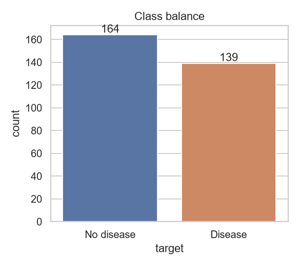

**Numeric feature distributions.** Patients with disease tend to have a lower maximum heart rate
(`thalach`) and a larger ST depression (`oldpeak`); most healthy patients have `oldpeak` near 0.
The disease group is concentrated around age 55-60, while `chol` and `trestbps` overlap heavily
between the classes, so they should carry little signal on their own. `chol` has one extreme
value (~560), which was kept because tree models and the scaler cope with it.

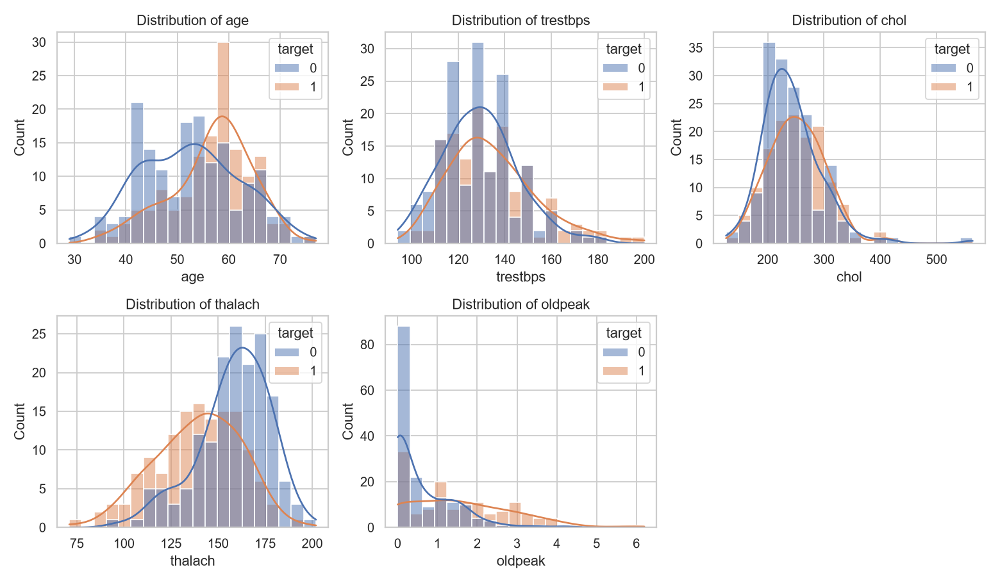

**Boxplots by target.** The same pattern is visible as medians: lower `thalach` and higher `oldpeak`
for the disease class.

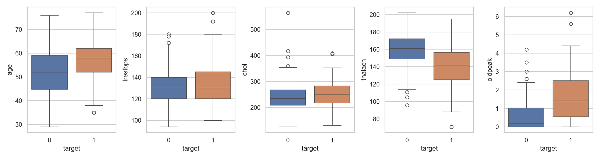

**Correlation heatmap.** The features most correlated with the target are `thal` (0.52), `ca` (0.46),
`exang` (0.43), `oldpeak` (0.42), `cp` (0.41) and `thalach` (-0.42). `chol` (0.09) and `fbs` (0.03)
are almost uncorrelated with it. `oldpeak` and `slope` are correlated with each other (0.58), which
is mild multicollinearity and is the reason the L2-regularised logistic regression is a reasonable choice.

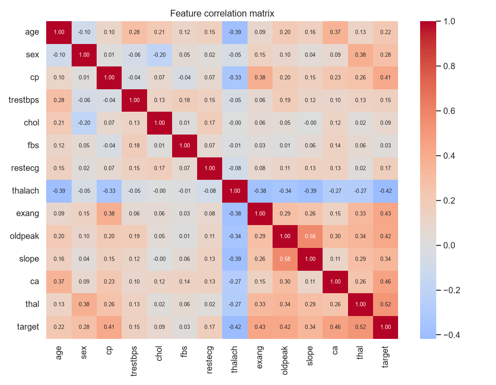

**Categorical features vs target.** Chest pain type 4 (asymptomatic), exercise-induced angina,
`thal` = 7 (reversible defect) and a non-zero count of major vessels (`ca`) are all strongly
associated with disease. Men make up most of the disease cases in this sample.

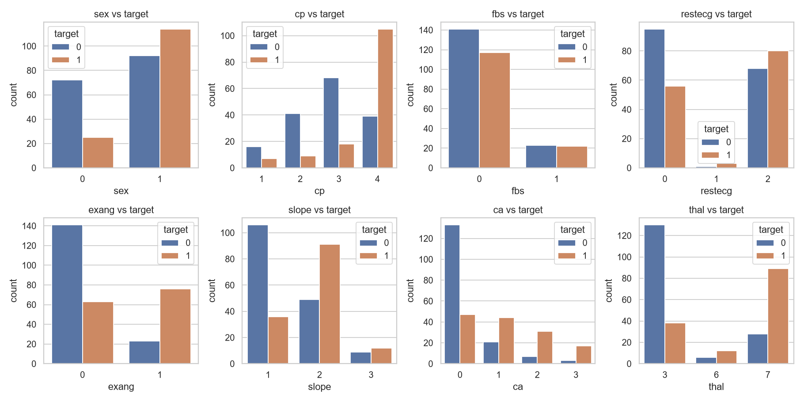

## 4. Features and modelling

All preprocessing lives inside one scikit-learn `Pipeline`, so the exact same transformations are
applied in training and serving:

- Numeric (`age, trestbps, chol, thalach, oldpeak`): `StandardScaler`
- Categorical (`sex, cp, fbs, restecg, exang, slope, ca, thal`): `OneHotEncoder(handle_unknown="ignore")`

Data split: 80/20 stratified (random_state 42). Hyper-parameters tuned with 5-fold stratified
`GridSearchCV` on the training set, optimising ROC-AUC. The test set was only used for the final
reported numbers.

| Model | Best params | CV acc | CV precision | CV recall | CV ROC-AUC | Test acc | Test recall | Test ROC-AUC |
|---|---|---|---|---|---|---|---|---|
| Logistic Regression | C=1 | 0.847 | 0.877 | 0.783 | 0.902 | 0.885 | 0.929 | 0.966 |
| Random Forest | 400 trees, depth 5, min leaf 3 | 0.814 | 0.831 | 0.755 | 0.904 | 0.852 | 0.893 | 0.955 |

Random Forest has marginally the highest CV ROC-AUC (0.904 vs 0.902) so it is the model selected
automatically by `src/train.py` and packaged. The difference is within noise (CV std is ~0.03-0.04);
logistic regression is simpler and equally good, which is worth noting as a trade-off.
On the held-out test set (61 patients) the Random Forest confusion matrix shows 27 true negatives,
25 true positives, 6 false positives and 3 false negatives (see section 5).

## 5. Experiment tracking (MLflow)

Each run logs: parameters (model, CV folds, best hyper-parameters), CV and test metrics, confusion
matrix and ROC plots (artifacts), and the fitted pipeline as an MLflow model. Backend is a local
SQLite DB (`mlflow.db`) with artifacts in `mlartifacts/`. View with
`mlflow ui --backend-store-uri sqlite:///mlflow.db`.

Two runs were logged in the `heart-disease-risk` experiment: `logreg-tuned` and `rf-tuned`.

**Run comparison: parameters.** The best hyper-parameters found by grid search for each model
(logistic regression `C=1`; random forest 400 trees, depth 5, min leaf 3).

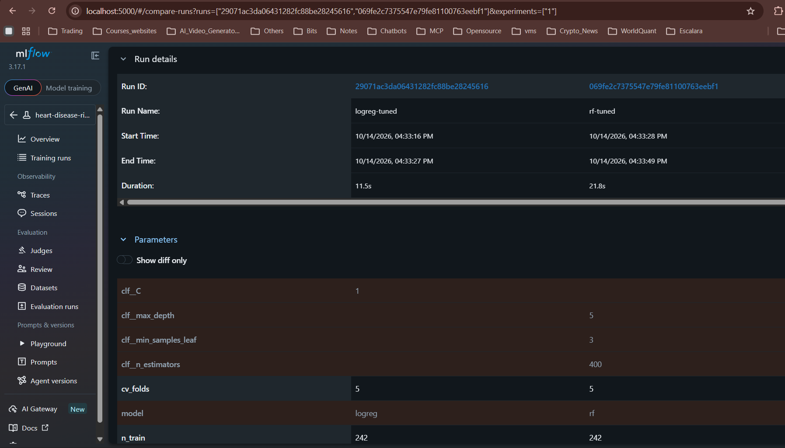

**Run comparison: metrics.** Test accuracy, precision, recall, F1 and ROC-AUC side by side.

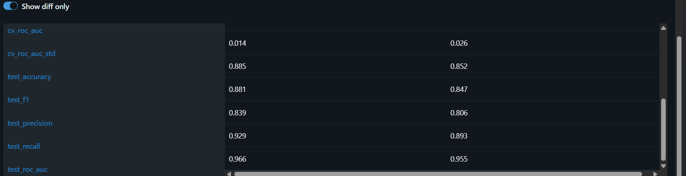

**Parallel coordinates view** of the tuned parameters against cross-validated accuracy.

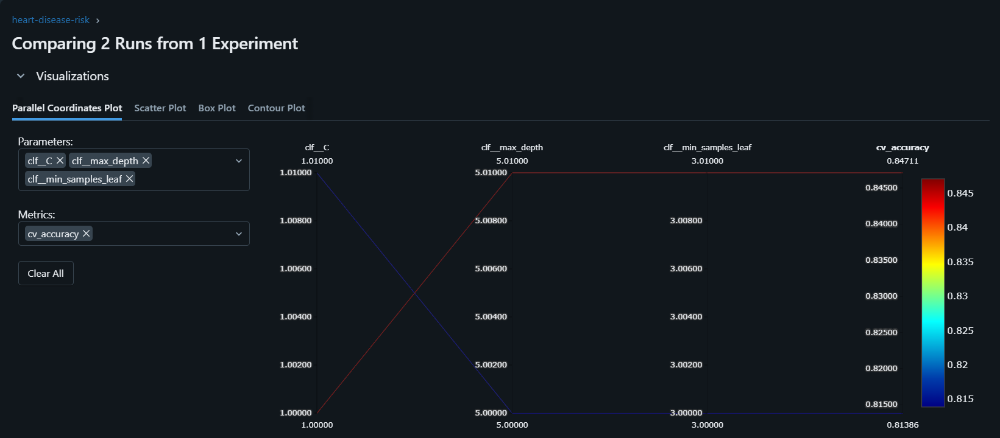

**Logged artifacts** for the random forest run: confusion matrix and ROC curve (AUC 0.95).

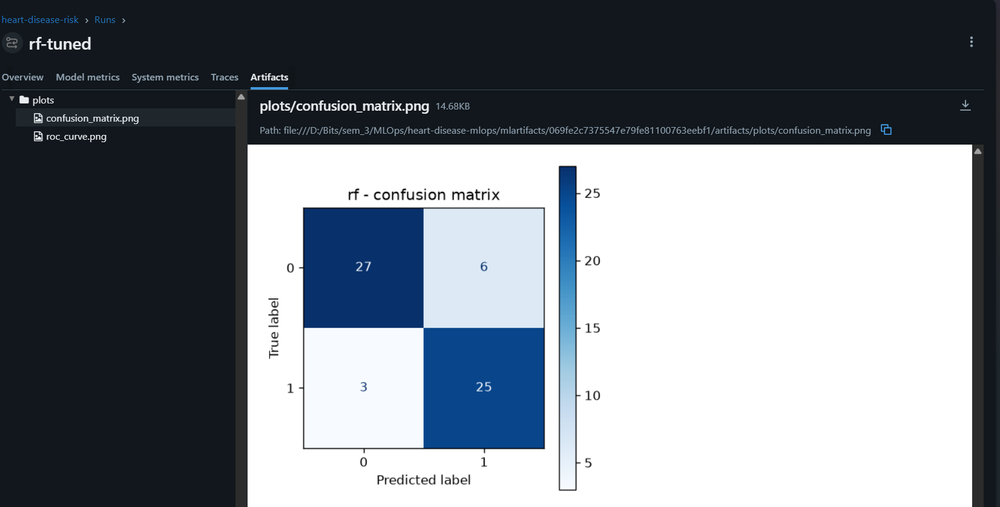

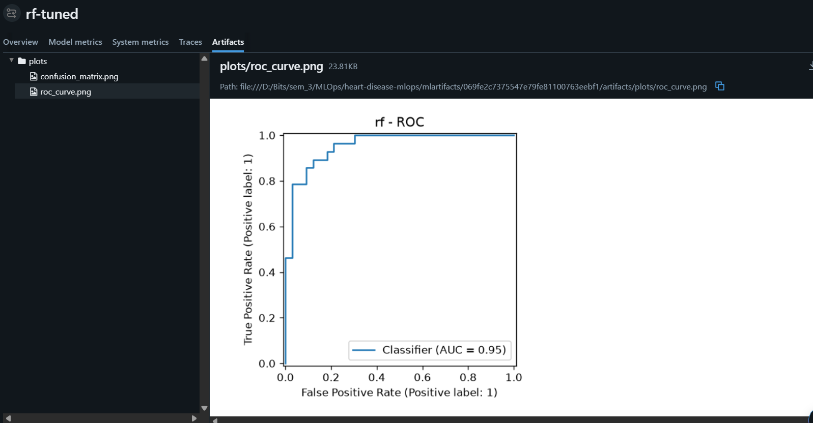

## 6. Packaging and reproducibility

- Final pipeline saved as `models/heart_pipeline.joblib` (preprocessing + classifier in one object)
  and also logged to MLflow.
- `requirements.txt` pins all training dependencies; `requirements-serve.txt` is the slim set used
  in the Docker image.
- Random seeds are fixed in `src/config.py`.

## 7. Testing and CI/CD

- `tests/` contains 15 tests: data cleaning, split, pipeline fitting, unseen-category handling,
  metrics, inference schema, and API endpoints (health, valid prediction, missing field, invalid
  `thal`, metrics).
- `.github/workflows/ci.yml` runs on every push/PR: install -> flake8 -> download data ->
  train -> pytest -> build Docker image and smoke-test `/health` and `/predict` -> upload
  models/reports/MLflow data as artifacts. Any lint, test or build failure fails the workflow.

The workflow run succeeded in about 2 minutes 18 seconds and uploaded one artifact bundle
(`pipeline-artifacts`, 1.04 MB) containing the model, reports and MLflow data.

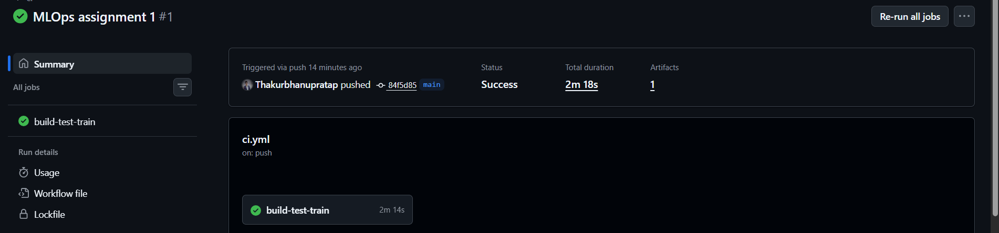

Step logs: data download, model training (selected model: rf) and unit tests.

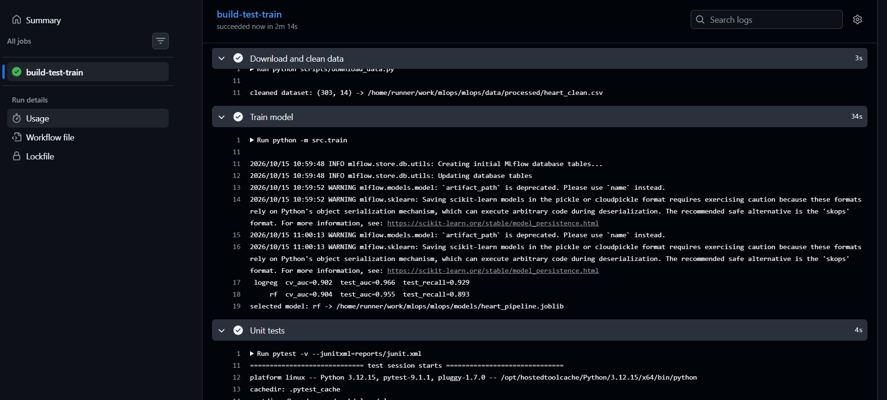

Artifacts produced by the run.

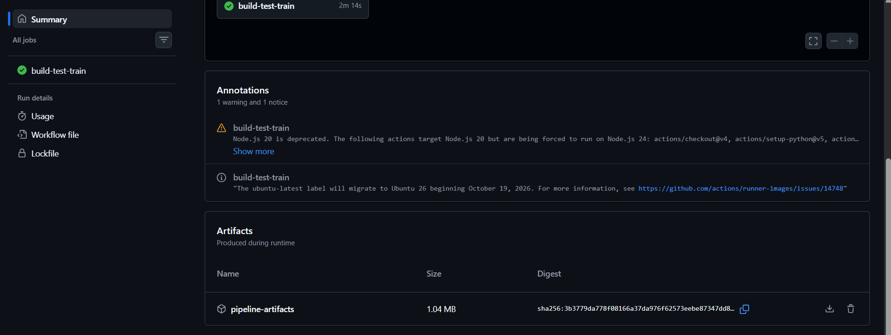

## 8. Containerisation

`Dockerfile` (python:3.12-slim, non-root user, healthcheck) serves `api.main:app` with uvicorn.

`POST /predict` accepts the 13 features as JSON and returns `prediction`, `confidence` and
`probability_disease`. Inputs are validated by pydantic (ranges, `thal` in {3, 6, 7}).

**Build.** `docker build -t heart-api:1.0 .` completes and tags the image (660 MB).

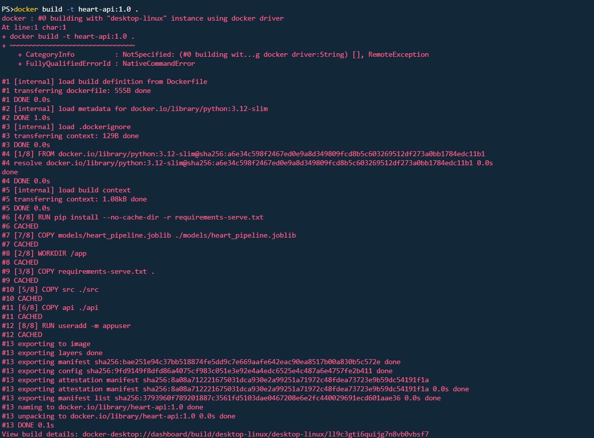

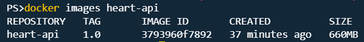

**Run.** The container starts, loads the model on startup and listens on port 8000.

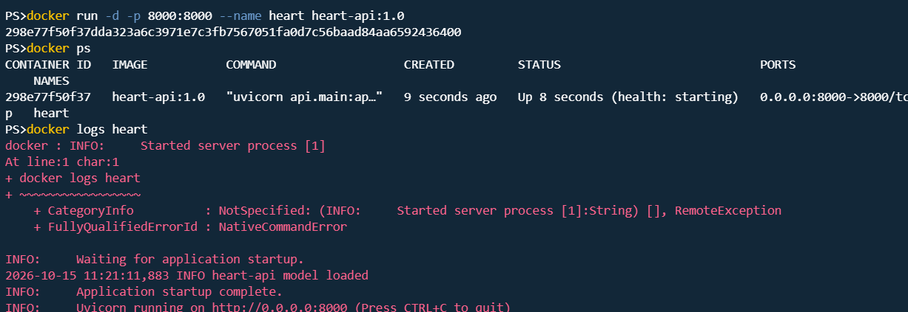

**Prediction request.** A sample patient posted to `/predict` returns the predicted class, the
confidence of that prediction and the probability of disease.

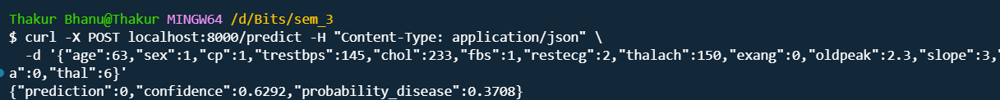

## 9. Deployment

The API is deployed locally as containers with Docker Compose (`docker-compose.yml`): the API
container (built from the project `Dockerfile`), Prometheus and Grafana run together on one
Docker network and are reachable on ports 8000, 9090 and 3000 (screenshots in sections 8 and 10).

Access instructions for local testing: `docker compose up --build`, then
`POST http://localhost:8000/predict` (interactive docs at `http://localhost:8000/docs`).

Kubernetes manifests are included in `k8s/` (Deployment with 2 replicas and health probes, a
LoadBalancer Service and an optional Ingress) but they were not deployed to a cluster for this
submission.

## 10. Monitoring and logging

- Every request is logged (method, path, status, latency) and prediction results are logged.
- `/metrics` exposes Prometheus metrics: `api_requests_total`, `api_request_latency_seconds`,
  `model_predictions_total`.
- `docker compose up` starts the API, Prometheus and Grafana with a pre-provisioned dashboard
  (request rate, p95 latency, predictions per class, error rate).

**Prometheus** scrapes the API every 5 seconds; the `heart-api` target is UP.

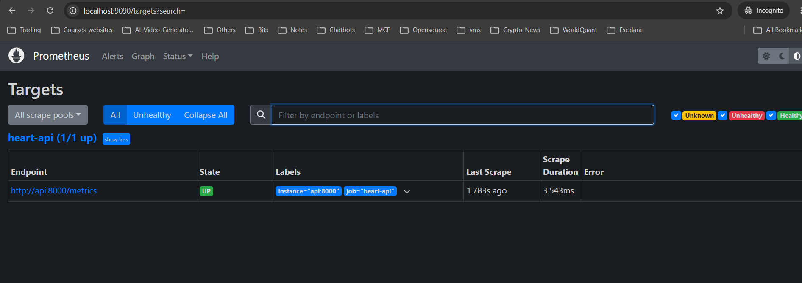

**Grafana dashboard** after running `scripts/load_test.py`: request rate per endpoint, p95 latency,
predictions per class and the rate of 4xx/5xx responses (the load script sends some invalid
requests on purpose, which is why the error panel shows a spike).

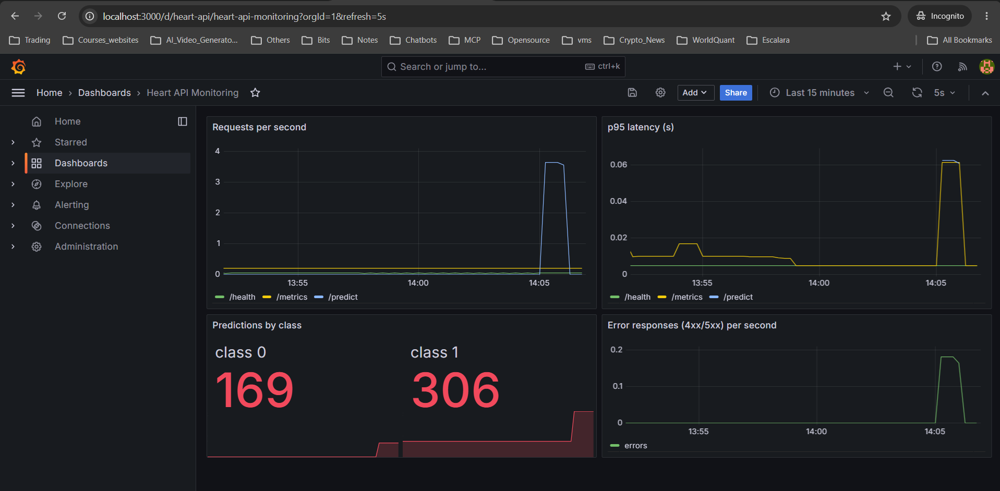

**API logs.** Each request is logged with method, path, status code and latency.

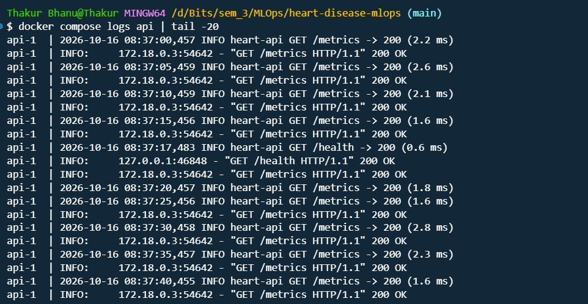

**Raw metrics** exposed at `/metrics`.

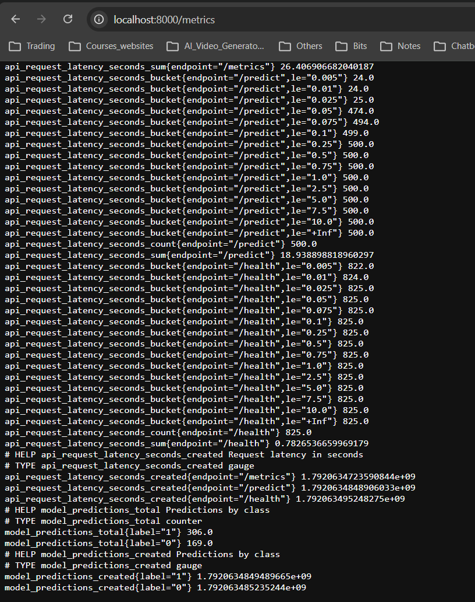

## 11. Architecture

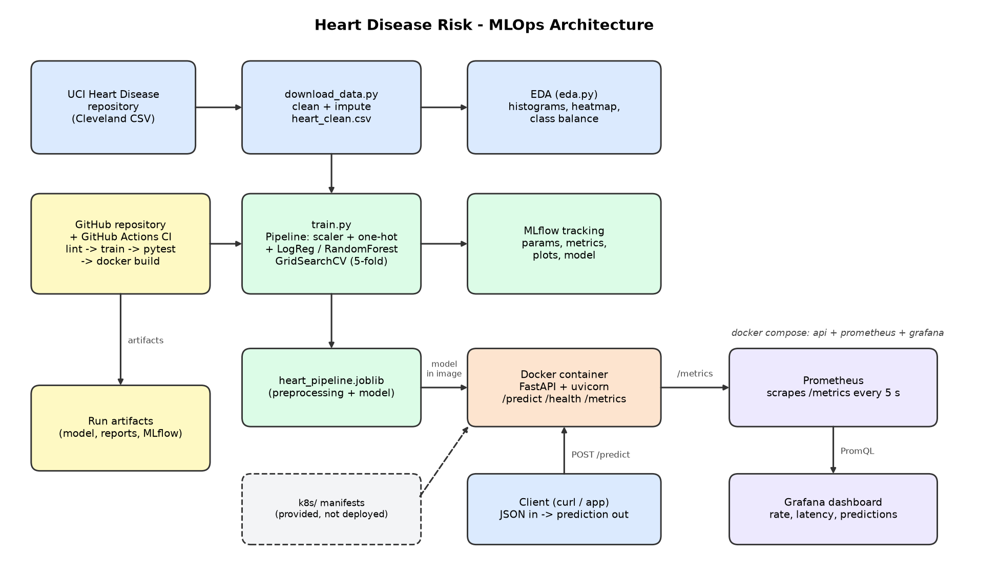

The data flows from the UCI repository through cleaning and EDA into training. Training logs every
run to MLflow and saves one pipeline file, which is baked into the Docker image. GitHub Actions
re-runs lint, training, tests and the Docker build on every push. The running container exposes
`/metrics`, which Prometheus scrapes and Grafana visualises.

## 12. Limitations and next steps

- Only 303 rows, so test metrics have high variance.
- No automatic retraining or drift detection; the next step would be data-drift metrics and a
  scheduled retraining workflow.
- Model is a decision-support demo, not a medical device.

## 13. Demo video

A short walkthrough of the pipeline (architecture, EDA, training, MLflow, CI, Docker, API
prediction, Prometheus/Grafana monitoring):
https://drive.google.com/file/d/14Asgfh7xBR8TSk25dNophkGbxzHgQu49/view?usp=sharing

The same file is also in the repository at `demo/pipeline_demo.mp4`.
